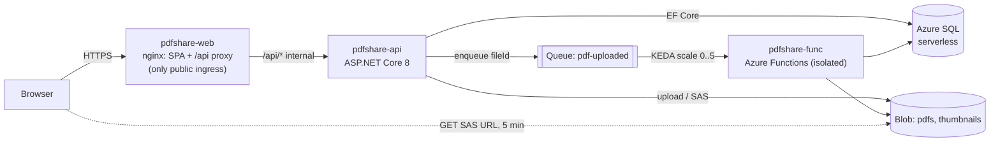

# PdfShare

Upload PDF files, keep them in Azure Blob Storage, and share them with a **public link** (anyone can download) or a **restricted link** (only users chosen by the owner, download only).

- **Backend**: ASP.NET Core 8 Web API with a Clean/Onion layout (same structure and auth model as the SmartEcommerceDigitalTwin backend), EF Core + Azure SQL.
- **Storage**: private Azure Blob containers. Downloads go through short-lived (5 min) read-only SAS URLs.
- **Azure Function** (queue trigger): validates every uploaded PDF, counts pages and renders a first-page preview.
- **Frontend**: React 18 + Vite + TypeScript, Feature-Sliced Design. See [FrontEnd/README.md](FrontEnd/README.md).
- **Hosting**: Azure Container Apps, with infrastructure as code in [deploy/azure/main.bicep](deploy/azure/main.bicep) and CI/CD in [.github/workflows/ci-cd.yml](.github/workflows/ci-cd.yml).

## Architecture



**Upload flow**
1. The SPA posts multipart data to `POST /api/files`.
2. The API checks the size (20 MB max), the extension and Content-Type, and the `%PDF-` signature.
3. The API streams the file to `pdfs/{ownerId}/{fileId}.pdf` and inserts a `PdfFiles` row with status `Processing`.
4. The API puts `{ fileId }` on the `pdf-uploaded` queue.
5. The Function parses the file with PDFium:
   - valid PDF → stores the page count, saves a PNG preview to `thumbnails/`, sets the status to `Ready`;
   - invalid PDF → sets `Rejected` and deletes the blob.
6. The SPA polls the file list while any file is `Processing`.

**Why a queue and not a Blob trigger.** Blob triggers on Flex Consumption and Container Apps need Event Grid, which Azurite cannot emulate. The queue behaves the same locally and in Azure, retries failures with a poison queue (`pdf-uploaded-poison`), and the message is only sent after the DB row exists.

**Why one origin (`/api` proxy).** nginx serves the SPA and proxies `/api/*` to the API, which is internal-only in Azure. This gives:
- no CORS;
- a refresh cookie that can be `SameSite=Strict`;
- one frontend image for every environment (the API URL is not baked in at build time).

## Repository layout

```
BackEnd/
  PdfShare.SharedKernel        Error record + Result helpers (CSharpFunctionalExtensions)
  PdfShare.Domain              models (Create → Result<T>), DTOs, interfaces, errors, options
  PdfShare.Core                services: authentication, files, share links, access rules, JWT
  PdfShare.DataAccess.SqlServer  DbContext (Identity), entities + configs, repositories, migrations
  PdfShare.Infrastructure      Blob Storage (SAS) and Storage Queue
  PdfShare.API                 controllers, JWT bearer + session check, ProblemDetails, Swagger
  PdfShare.Functions           ProcessPdf queue-triggered function (PDFium via PDFtoImage)
  PdfShare.UnitTests           xUnit + Moq + FluentAssertions
  PdfShare.IntegrationTests    NUnit against real SQL Server (migrations applied to a throw-away DB)
FrontEnd/                      React SPA (FSD) + nginx image
deploy/azure/main.bicep        Container Apps, ACR, SQL, Storage, Key Vault, identity, monitoring
docker-compose.yml             full local stack
.env.example                   local configuration template
```

## Run locally

There is **one** config file for local development: the repo-root `.env` (git-ignored). The API, the Function, the Vite dev server and `docker compose` all read it. Create it once from the template:

```powershell
Copy-Item .env.example .env
```

The only other local file is `BackEnd/PdfShare.Functions/local.settings.json`. It holds the three settings the Functions **host** itself reads (storage for the host and the queue trigger) and is the same on every machine.

### Option 1: everything in Docker

```powershell
docker compose up --build
```

| URL (default ports from `.env`) | What |
|---|---|
| http://localhost:3000 (`WEB_PORT`) | the app (nginx proxies `/api`) |
| http://localhost:5041/swagger (`API_PORT`) | API Swagger (Development) |
| localhost:1433 (`DB_PORT`) | SQL Server (`sa` / `DB_PASSWORD`) |
| localhost:10000-10002 | Azurite (blob / queue / table) |

Demo users are seeded when `SEED_DEMO_USERS=true`: `alice@pdfshare.local` and `bob@pdfshare.local`, both with password `SEED_DEMO_PASSWORD` (default `Demo_Passw0rd!`).

### Option 2: run the code on the host and debug it in the IDE

Requirements: .NET 8 SDK, Node 20+, and [Azure Functions Core Tools v4](https://learn.microsoft.com/azure/azure-functions/functions-run-local).

1. Start Azurite and a database. **Without Docker** use Windows LocalDB (the default `DATABASE_URL` in `.env.example`) and Azurite from npm:

   ```powershell
   npx azurite --location .azurite --silent --loose --skipApiVersionCheck
   ```

   **With Docker**, run `docker compose up db azurite` and switch `DATABASE_URL` in `.env` to the commented `localhost,1433` variant.

2. Start the API (in Visual Studio use the `http` profile). It listens on `API_PORT`, applies migrations and seeds data on start.

   ```powershell
   dotnet run --project BackEnd/PdfShare.API
   ```

3. Start the Function. It reads `DATABASE_URL` and `BLOB_CONNECTION_STRING` from the same `.env`; create `local.settings.json` once:

   ```powershell
   Copy-Item BackEnd/PdfShare.Functions/local.settings.example.json BackEnd/PdfShare.Functions/local.settings.json
   ```

   ```powershell
   cd BackEnd/PdfShare.Functions; func start
   ```

4. Start the frontend. Vite serves it on `WEB_PORT` and proxies `/api` to `API_PORT`.

   ```powershell
   cd FrontEnd; npm install; npm run dev
   ```

**Migrations** use `dotnet-ef`, pinned as a local tool in `BackEnd/.config`:

```powershell
cd BackEnd; dotnet tool restore; dotnet ef migrations add <Name> -p PdfShare.DataAccess.SqlServer -s PdfShare.DataAccess.SqlServer
```

### Configuration

| Variable | Used by | Notes |
|---|---|---|
| `API_PORT`, `WEB_PORT`, `DB_PORT` | API, Vite, compose | ports on your machine (5041 / 3000 / 1433) |
| `DB_NAME`, `DB_PASSWORD` | compose | SQL Server container; compose builds its own connection string with host `db` |
| `DATABASE_URL` | API, Function | SQL connection string for a host run. In Azure it uses `Authentication=Active Directory Managed Identity` |
| `VITE_API_BASE_URL` | frontend build | keep `/api` (proxied by Vite / nginx) |
| `JWT_SECRET` | API | 32 characters or more (HS256). In Azure it comes from Key Vault |
| `ACCESS_TOKEN_MINUTES` / `REFRESH_TOKEN_DAYS` | API | defaults 15 / 30 |
| `BLOB_CONNECTION_STRING` | API, Function | Azurite / shared key. Leave it empty in Azure |
| `BLOB_SERVICE_URI`, `QUEUE_SERVICE_URI`, `AZURE_CLIENT_ID` | API, Function | Azure: identity-based storage access |
| `BLOB_PUBLIC_BASE_URL` | API | rewrites the SAS host (Docker: `azurite` → `localhost`) |
| `CORS_ORIGINS` | API | only needed if the SPA is served without the `/api` proxy |
| `SEED_DEMO_USERS`, `SEED_DEMO_PASSWORD` | API | demo accounts |
| `RUN_MIGRATIONS` | API | default `true` |

## API

There is no `api/` prefix on the backend; the proxy adds and strips it, as in the reference project. All errors are ProblemDetails with `errors: [{ code, description }]`, and the HTTP status comes from the code suffix:

| Code suffix | Status |
|---|---|
| `.NotFound` | 404 |
| `.Unauthorized` | 401 |
| `.Forbidden` | 403 |
| `.Conflict` | 409 |
| `.Expired` | 410 |
| `.LockedOut` | 429 |
| anything else | 400 |

| Method & route | Auth | Purpose |
|---|---|---|
| `POST user-registration`, `POST login` | anonymous, rate-limited | returns `{ id, email, role, accessToken }` and sets the HttpOnly `refreshtoken` cookie |
| `POST refresh-access-token` | cookie | new access token; the refresh token is **rotated** |
| `POST logout` | cookie | deletes the session, so the access token stops working immediately |
| `GET account`, `POST change-password` | user | change-password signs out all other sessions |
| `POST files` (multipart `file`) | user | upload a PDF (20 MB max) → `201`, status `Processing` |
| `GET files?page=&pageSize=` | user | my files, paged |
| `GET files/shared-with-me` | user | files shared with me through restricted links |
| `GET files/{id}/download-url`, `GET files/{id}/thumbnail-url` | owner | `{ url, expiresAt }` (SAS, 5 min) |
| `DELETE files/{id}` | owner | deletes the file, its preview and its links |
| `POST files/{id}/links` `{ type, userIds, expiresAt? }` | owner | create a `Public` or `Restricted` link |
| `GET files/{id}/links` | owner | list the file's links |
| `PUT links/{id}/users` | owner | replace the user list of a restricted link |
| `DELETE links/{id}` | owner | revoke a link |
| `GET users/search?email=` | user | prefix search for choosing users |
| `GET s/{token}`, `GET s/{token}/download-url` | anonymous for public links, listed user or owner for restricted | file info and SAS URL |

**Access rules** live in one place, `FileAccessService`:
- a revoked link answers 404, as if it had never existed;
- an expired link answers 410;
- a file that is not `Ready` cannot be shared;
- a public link works for anyone;
- a restricted link works only for the owner or a listed user; without sign-in the API returns 401, and for any other user 403.

Every change to a file or a link checks `OwnerId == currentUser` and otherwise returns 404, so listed users can only download.

## Authentication

The auth model is the same as in the reference project: ASP.NET Core Identity (`UserEntity : IdentityUser<Guid>`), `IIdentityService` so that Core never references Identity, JWTs built with the `JWT` library, a session table, and a refresh token in an HttpOnly cookie. `JwtBearerEvents.OnTokenValidated` rejects a token whose session no longer exists, which is what makes logout revoke access tokens.

Changes compared with the reference project:

| Area | Reference | Here |
|---|---|---|
| Access token lifetime | `exp` was 60 days while the API reported 10 minutes | 15 minutes, and `exp` matches the reported expiry |
| Refresh token | JWT stored in plain text, never rotated | opaque random token, stored as a **SHA-256 hash**, rotated on every refresh |
| Error status codes | every failure returned 400 | status derived from the error code (404/401/403/409/410/429) |
| Validation errors | different shape from business errors | same `errors[].code` shape as business errors |
| Middleware order | CORS ran after auth | `UseCors` runs before `UseAuthentication`/`UseAuthorization` |
| Dependency injection | registrations inline in `Program.cs` | `AddCore`, `AddDataAccess`, `AddIdentityStores`, `AddInfrastructure`, `AddJwtAuthentication` |
| Object mapping | AutoMapper 13 (3 high-severity advisories; the fixed versions are commercially licensed) | Mapster (MIT), keeping the same generic `ProjectToType<T>` repository pattern |
| Brute-force protection | none | rate limit of 10 requests/min per IP on login and registration (not on refresh, which runs on every page load), plus Identity lockout |

Also new: transactions run through `IUnitOfWork.ExecuteInTransactionAsync` inside the EF execution strategy, so SQL retries stay safe on Azure SQL serverless.

## Tests

```powershell
cd BackEnd; dotnet test
```

```powershell
cd FrontEnd; npm run lint; npm run test:run
```

- **Unit tests (65)** cover:
  - domain rules: file validation and name sanitizing, share-link invariants;
  - the access matrix;
  - files, auth and refresh-token rotation;
  - a check that the JWT is accepted by ASP.NET's own token validation;
  - error-to-status mapping, SAS URL rewriting and mapping config;
  - the Function's state machine;
  - real PDFium rendering of a PDF.
- **Integration tests (9)** run on SQL Server with all migrations applied. They cover projections, cascades, idempotent `MarkReady`, the shared-with-me filters (revoked, expired, not ready), session rotation and user search. They use LocalDB by default, or set `INTEGRATION_SQL_SERVER` (CI uses an mssql service container).
- **Frontend tests**: vitest + Testing Library + msw.
- **E2E (Playwright)** against a running stack: `e2e/full-flow.spec.ts` covers the whole journey:
  - registration, client-side validation, upload → `Ready`/`Rejected` by the Function, thumbnail;
  - real downloads, public link (anonymous), restricted link (login redirect, "No access" for others), "Shared with me";
  - revoke, delete, reload, logout.

  Each run creates its own users and deletes its files. Set `E2E_CHANNEL=msedge` (or `chrome`) to use an installed browser instead of `npx playwright install`:

  ```powershell
  $env:E2E_CHANNEL = 'msedge'; npm --prefix FrontEnd run test:e2e
  ```

## Deploy to Azure (Container Apps)

1. Create the infrastructure. The first run deploys placeholder images.

   ```powershell
   az group create -n rg-pdfshare -l westeurope
   ```

   ```powershell
   az deployment group create -g rg-pdfshare -f deploy/azure/main.bicep -p jwtSecret=<random 48+ chars>
   ```

2. Set up GitHub OIDC by creating an app registration with a federated credential for this repository. Grant it the `Contributor` and `User Access Administrator` roles on the resource group (Bicep assigns roles to the managed identity), plus `AcrPush` on the registry. Then add:
   - repository secrets: `AZURE_CLIENT_ID`, `AZURE_TENANT_ID`, `AZURE_SUBSCRIPTION_ID`, `JWT_SECRET`;
   - repository variables: `AZURE_RESOURCE_GROUP`, `AZURE_ACR_NAME` (the `acrName` output of step 1).
3. Push to `main`. The workflow runs the backend and frontend tests, builds three images with `az acr build`, and redeploys the Bicep template with `imageTag=<commit sha>`. The app URL is the `webUrl` output.

**What gets deployed:**
- `pdfshare-web`, the only public ingress;
- `pdfshare-api`, internal ingress, 1–3 replicas, `/health` probes;
- `pdfshare-func`, no ingress, scales 0–5 with KEDA on the `pdf-uploaded` queue length;
- ACR, Storage (shared-key access disabled), Azure SQL serverless with Entra-only auth (auto-pause), Key Vault for `JWT-SECRET`, Log Analytics and Application Insights;
- a single user-assigned managed identity for ACR pull, Blob/Queue data access, User Delegation SAS, Key Vault and SQL.

> Simplification for the test assignment: the app's managed identity is also the SQL Entra admin, so EF migrations run without a manual `CREATE USER` step. In production, use a separate admin group and a least-privilege database user, and run migrations as a separate pipeline step (`efbundle`).

## Known limitations / next steps

- The UI creates and revokes links, but editing the user list of an existing restricted link is API-only for now (`PUT links/{id}/users`).
- If enqueueing fails after a successful upload, the file stays `Processing` (the failure is logged). A timer function that re-enqueues stale `Processing` files would close that gap.
- No malware scanning. Microsoft Defender for Storage could be enabled on the storage account.
- Access tokens are not bound to an issuer or audience: there is a single API and a single client.
